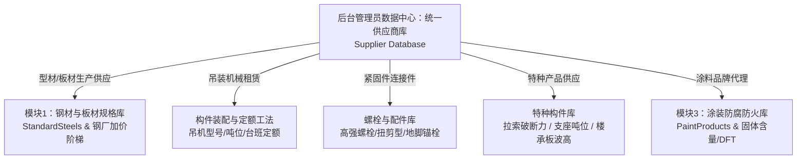

# 供应链与供应商库 (Supplier Database) 实施方案计划 (v2 - 支持动态品类扩展与管理员模式)

## 一、架构定位与跨模块规格关系

### 1. 业务实体与产品规格的关系模式
**厂家对应的具体产品规格和力学/施工参数分布在各自对应的专业模块中，供应商库作为统一的「企业实体与供方名录中心」通过主键/外键进行关联。**

各业务领域的规格与供应商归属关系：

### 2. 动态品类扩展与后台管理员模式设计
1. **产品品类与子类动态扩展 (Extensible Category & SubCategory)**：
   - 基础大类（`Category`）：钢厂、贸易商、施工机械、特种构件与材料、防腐涂装、**连接与紧固件 (Fasteners & Bolts)** 等。
   - 细分子类（`SubCategory`）：支持动态新增。系统预置：**高强螺栓 (10.9S大六角/扭剪型)、地脚锚栓、化学锚栓、空间拉索、减隔震支座、闭口/开口楼承板、焊接材料** 等。
   - **支持管理员在后台随时添加新的物料/产品分类**，无需修改核心枚举代码，满足未来各类新型建材的扩展需求。
2. **后台管理员维护与前台工程师引用（权责分离）**：
   - **后台管理端**：在「后台基础数据库工作站 (`DatabaseManagementModal`)」及系统配置面板中，提供完整的管理员新增分类、录入新供应商、资质审核标记、停用/归档功能。
   - **前台业务端**：各业务工作台（材料价格、截面设计、防腐涂装、构件装配）仅以下拉/联想方式读取合格在册供应商，防止前台人员随意篡改企业档案。

---

## 二、详细实施步骤

### 阶段 1：数据模型与动态品类设计 (Shared Models)
- [ ] 创建 `SupplierCategory` 体系（保留主类型分组，并支持动态自定义子类）：
  - `SteelMill` (钢厂制造)
  - `SteelTrader` (贸易现货)
  - `CraneRental` (吊机机械)
  - `FastenerBolt` (连接与紧固件：高强螺栓、地脚螺栓等)
  - `SpecialtyMaterial` (特种材料：拉索/支座/楼承板/焊材/保温等)
  - `PaintCoating` (防腐涂装)
  - `OtherCustom` (自定义新型品类)
- [ ] 创建 `SupplierItem`（共享业务模型）与 `SupplierEntity`（EF Core 持久化实体）：
  - 属性：`Id`, `Code`, `Name`, `ShortName`, `Category`, `SubCategory` (动态标签，如 "10.9S高强螺栓", "建筑减隔震支座"), `ContactPerson`, `ContactPhone`, `Email`, `CityRegion`, `CooperationStatus`, `Remarks`, `CreatedAt`, `UpdatedAt`。
- [ ] 在 `MaterialProvenanceRecordEntity` 与 `PaintProductEntity` 中加入 `SupplierId` 外键关联字段。

### 阶段 2：预设数据库初始化与持久化 (Server & SQLite)
- [ ] 在 `AppDbContext` 注册 `DbSet<SupplierEntity> Suppliers`。
- [ ] 在 `AppDbContext.SeedData` 中编制中国工程行业标杆企业种子数据（新增螺栓与紧固件龙头）：
  1. **钢厂制造**：宝武集团（宝钢股份）、鞍钢股份、首钢股份、沙钢集团、南钢股份等；
  2. **钢材贸易商**：欧冶云商、上海五矿、物产中大、浙商中拓、建发股份等；
  3. **吊机设备租赁**：上海庞源机械工程、中联重科租赁、徐工起重服务、中核华兴达丰等；
  4. **连接与紧固件 (新增)**：上海标五（高强螺栓）、晋亿实业、七丰精工、河北永年标准件基地龙头等；
  5. **特种材料商**：
     - 拉索索具：巨力索具、江苏法尔胜、贵州钢绳；
     - 减隔震支座：柳州欧维姆(OVM)、株洲时代新材、丰泽股份；
     - 楼承板围护：精工绿筑、多维联合、长江精工；
  6. **涂料防腐商**：佐敦涂料(Jotun)、阿克苏诺贝尔(AkzoNobel)、中远关西、海虹老人(Hempel)、宣伟等。
- [ ] 在 `Program.cs` 暴露 RESTful API：支持增删改查、品类动态检索与数据重置。

### 阶段 3：前端工作台与后台管理界面 (Client UI)
- [ ] 优化 `DatabaseManagementModal.razor`（后台基础数据库工作站）：
  - 增加管理员专属「🏢 供应商与品类管理中心」Tab；
  - 支持管理员**动态新增产品分类/子类**与录入新供应商档案；
  - 提供数据导入导出与初始数据恢复保护。
- [ ] 建设一级页面 `SuppliersWorkbench.razor` (`/suppliers`)：
  - 具备全量视图切换：网格表格视图 (Grid View) 与 企业名片卡片视图 (Card View)；
  - 动态品类胶囊过滤栏（自动根据数据库中现存的分类和子类生成筛选按钮，如自动提取“高强螺栓”、“空间拉索”等，支持动态增加）；
  - 快速模糊检索（名称、代码、联系人、城市）；
  - 供应商快速新建/编辑模态窗。
- [ ] 更新 `NavMenu.razor` 与 `WorkbenchPortal.razor`，提供清晰直观的模块入口。

### 阶段 4：自动化测试与验证 (Unit Tests)
- [ ] 在 `EngineeringApp.Tests` 编写 `SupplierDatabaseTests.cs`：
  - 验证预设数据完整性（包含螺栓紧固件在内的各大分类）；
  - 验证动态子分类添加与过滤检索功能；
  - 验证供应商 CRUD 增删改查逻辑与外键关联。
- [ ] 运行 `dotnet test`，确保全部测试用例 100% 通过。
