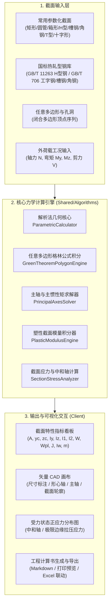

# 截面特性计算与力学分析工作站 (Section Property Calculator) 实施计划

本方案旨在为土木工程、结构工程与钢结构设计打造一套高精度、开箱即用的**截面几何与力学特性综合计算工作站**。遵循工程力学规范与现行国家标准，提供常用参数化截面、国标型钢标准库、任意多边形数值积分、双向偏压弯剪内力应力校核以及实时矢量图形可视化。

---

## 一、 用户审查要点 (User Review Required)

> [!IMPORTANT]
> **技术栈架构对齐 (`AGETNS.md`)**：
> 工作区根目录下配置了针对土木工程系统的规范文档 `AGETNS.md`，强制要求采用 **C# (.NET 9.0) + Blazor WebAssembly (WASM)** 生态，算法与 UI 解耦存放于 `Shared/Algorithms`。
> 我们推荐严格按照该规范实施一套无需安装额外复杂环境、支持在浏览器或桌面 WebView 中极速离线运算的 Blazor WASM 工程应用；若您希望改为 Python (PyQt6 / Streamlit)，亦可一键切换。

> [!TIP]
> **计算深度全面覆盖**：
> 不仅涵盖基础截面参数（面积 $A$、质心 $(y_c, z_c)$、惯性矩 $I_y, I_z$、惯性半径 $i_y, i_z$、弹性截面模量 $W_{el}$），更深度支持**主惯性轴与转角 $\alpha_p$**、**塑性截面模量 $W_{pl}$**、**圣维南扭转常数 $J$**、**翘曲惯性常数 $I_w$**，并具备**内力工况 ($N, M_y, M_z, V$) 截面正应力云图与中和轴验算**。

---

## 二、 核心功能模块设计



---

## 三、 结构力学计算算法详述

### 1. 任意多边形截面的格林公式数值线积分 (Green's Theorem)
对于由 $N$ 个顶点组成的任意闭合平面多边形（支持带内环空洞，通过逆时针外环、顺时针内环进行代数求和）：
- **面积**：
  $$A = \frac{1}{2} \sum_{i=1}^{N} (y_i z_{i+1} - y_{i+1} z_i)$$
- **形心静力矩**：
  $$S_y = \int z \, dA = \frac{1}{6} \sum_{i=1}^{N} (y_i z_{i+1} - y_{i+1} z_i)(z_i + z_{i+1})$$
  $$S_z = \int y \, dA = \frac{1}{6} \sum_{i=1}^{N} (y_i z_{i+1} - y_{i+1} z_i)(y_i + y_{i+1})$$
  形心坐标为 $y_c = S_z / A, \quad z_c = S_y / A$。
- **关于原点的惯性矩与惯性积**：
  $$I_{y0} = \frac{1}{12} \sum (y_i z_{i+1} - y_{i+1} z_i)(z_i^2 + z_i z_{i+1} + z_{i+1}^2)$$
  $$I_{z0} = \frac{1}{12} \sum (y_i z_{i+1} - y_{i+1} z_i)(y_i^2 + y_i y_{i+1} + y_{i+1}^2)$$
  $$I_{yz0} = \frac{1}{24} \sum (y_i z_{i+1} - y_{i+1} z_i)(y_i z_{i+1} + 2 y_i z_i + 2 y_{i+1} z_{i+1} + y_{i+1} z_i)$$
- **移轴到形心主轴 (Parallel Axis Theorem)**：
  $$I_y = I_{y0} - A z_c^2, \quad I_z = I_{z0} - A y_c^2, \quad I_{yz} = I_{yz0} - A y_c z_c$$

### 2. 主惯性矩与主轴偏角 (Principal Axes)
- **主惯性矩**：
  $$I_{1,2} = \frac{I_y + I_z}{2} \pm \sqrt{\left(\frac{I_y - I_z}{2}\right)^2 + I_{yz}^2}$$
- **主轴方位角**：
  $$\alpha_p = \frac{1}{2} \operatorname{atan2}(-2 I_{yz}, I_y - I_z)$$
- **回转半径**：
  $$i_y = \sqrt{I_y / A}, \quad i_z = \sqrt{I_z / A}, \quad i_1 = \sqrt{I_1 / A}, \quad i_2 = \sqrt{I_2 / A}$$

### 3. 塑性截面模量与中和轴 (Plastic Section Modulus)
通过等分截面面积确定水平/垂直塑性中和轴位置 $z_{pna}, y_{pna}$，使得轴线两侧面积相等 $A_{upper} = A_{lower} = A / 2$，随后计算面积一阶静矩总和：
$$W_{pl,y} = \int |z - z_{pna}| \, dA, \quad W_{pl,z} = \int |y - y_{pna}| \, dA$$

### 4. 复合受力截面正应力验算与中和轴 (Stress Distribution)
在已知外荷载轴力 $N$、双向弯矩 $M_y, M_z$ 时，截面上任一点 $(y, z)$ 处的正应力为：
$$\sigma(y, z) = \frac{N}{A} + \frac{M_y \cdot z'}{I_y} - \frac{M_z \cdot y'}{I_z}$$
（其中 $y', z'$ 为相对于形心的坐标）
中和轴直线方程即为 $\sigma(y, z) = 0$。工作站将高亮标出截面最大拉应力点 $\sigma_{max}$ 与最大压应力点 $\sigma_{min}$，并与材料容许应力 $[f]$ 进行合规性校核比对。

---

## 四、 拟新增与改动的项目文件结构

遵循 `AGETNS.md` 规定的目录组织：

```
d:\pycharmproject\test\
├── AGENTS.md (重命名修正 AGETNS.md 拼写)
├── SectionCalculator.sln
├── src/
│   ├── EngineeringApp.Shared/                 # 跨平台纯力学与几何核心库
│   │   ├── EngineeringApp.Shared.csproj
│   │   ├── Models/
│   │   │   ├── SectionType.cs                # 截面类型枚举 (矩形/圆/箱型/H型等)
│   │   │   ├── SectionParameters.cs          # 几何尺寸参数模型
│   │   │   ├── SectionPropertiesResult.cs    # 完整计算结果对象 (A, I, W, J, Iw, m等)
│   │   │   ├── MaterialProfile.cs            # 结构材料库 (Q235, Q355, 6061, C30等)
│   │   │   ├── StandardSteelItem.cs          # 国标热轧型钢型号条目
│   │   │   └── LoadCase.cs                   # 荷载工况模型 (N, My, Mz, Vy, Vz)
│   │   ├── Data/
│   │   │   └── StandardSteelDatabase.cs      # 内置 GB/T 11263 / GB/T 706 型钢数据库
│   │   └── Algorithms/
│   │       ├── ISectionCalculator.cs         # 计算器统一接口
│   │       ├── ParametricSectionCalculator.cs# 常用截面解析计算器
│   │       ├── GreenTheoremPolygonEngine.cs  # 任意多边形格林公式积分引擎
│   │       ├── TorsionWarpingEngine.cs       # 扭转常数 J 与翘曲常数 Iw 近似/解析引擎
│   │       └── StressAnalysisEngine.cs       # 内力应力状态与中和轴求解
│   ├── EngineeringApp.Client/                 # Blazor WebAssembly 响应式客户端
│   │   ├── EngineeringApp.Client.csproj
│   │   ├── Program.cs
│   │   ├── App.razor
│   │   ├── Pages/
│   │   │   └── SectionWorkstation.razor      # 主截面特性计算工程视窗
│   │   ├── Shared/
│   │   │   ├── SectionSvgCanvas.razor        # CAD 矢量截面绘图与应力中和轴显示组件
│   │   │   ├── SteelProfileModal.razor       # 国标型钢库快速筛选弹窗
│   │   │   └── CalculationReportModal.razor  # 计算书排版与导出组件
│   │   └── wwwroot/
│   │       ├── css/app.css                   # 现代化工程深色/浅色配色样式
│   │       └── index.html
│   └── EngineeringApp.Tests/                  # 算法自动化单元测试套件
│       ├── EngineeringApp.Tests.csproj
│       ├── ParametricSectionsTests.cs        # 验证矩形、圆管、工字钢力学解析解
│       └── PolygonIntegrationTests.cs        # 验证多边形格林公式与精确解对比误差 (<0.01%)
```

---

## 五、 验证与质量保证方案 (Verification Plan)

### 1. 自动化单元测试 (Automated Unit Tests)
- **矩形截面基准测试**：$b=200\text{mm}, h=400\text{mm}$
  - $A = 80000\text{ mm}^2$
  - $I_y = \frac{1}{12} b h^3 = 1.0667 \times 10^9\text{ mm}^4$
  - $I_z = \frac{1}{12} h b^3 = 2.6667 \times 10^8\text{ mm}^4$
  - $W_{pl,y} = \frac{1}{4} b h^2 = 8.0 \times 10^6\text{ mm}^3$
  - 自动断言数值误差 $\le 10^{-6}$。
- **国标热轧型钢基准测试**：选取标准工字钢与 H 型钢（例如 HW200×200×8×12），比对格林公式积分与标准规范表格官方出厂参数，相对误差控制在 $0.5\%$ 以内（考虑根部倒角 $r$ 影响）。
- **运行命令**：
  ```powershell
  dotnet test src/EngineeringApp.Tests/EngineeringApp.Tests.csproj
  ```

### 2. 界面与交互验证 (Manual Verification)
1. 启动 Blazor 应用并在浏览器中加载：
   ```powershell
   dotnet run --project src/EngineeringApp.Client/EngineeringApp.Client.csproj
   ```
2. 切换截面类别：实心矩形、空心圆管、箱形截面、H型钢、槽钢、角钢，观察 SVG 画布尺寸标注线与形心指示器是否实时联动；
3. 从“国标型钢库”选取典型型号（如 HW300x300），验证所有几何参数自动填充，计算指标瞬间呈现；
4. 切换到“任意多边形”模式，粘贴顶点多边形坐标，验证凹多边形与带孔洞截面的形心及主惯性矩自动精确计算；
5. 输入荷载工况（$N = -500\text{kN}, M_y = 60\text{kN}\cdot\text{m}$），观察正应力分布梯度图与中和轴位置渲染。
