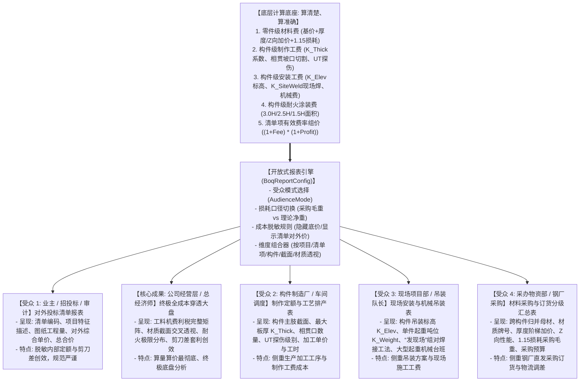

# 钢结构大型工程 BOQ 数据库架构设计、对外多维报表与大盘分析实施方案 (V9 独立费率配置与开放式多受众报表协同版)

> **归档位置**：`doc/steel_boq_database_and_reporting_plan.md`  
> **核心升级亮点**：
> 1. **费率分级机制（全局默认 vs 清单项独立覆盖）**：
>    * 项目层 `BoqProjectEntity` 维护项目级全局默认企业管理费率（默认 8%）与利润率（默认 7%）；
>    * 清单项层 `BoqTenderItemEntity`（`NH`、`NF`、`HL`、`WH`、`JLC`）支持**单独设置自定义管理费率与利润率**（通过 `IsCustomRateEnabled` 开关），实现工程商务中经典的不平衡报价策略（对增量概率大的单项提升利润率，对竞争激烈的单项下调费率），未自定义时自动继承项目全局默认费率。
> 2. **“先算清楚”核心导向下的开放式多受众报表架构**：
>    * **核心立足点**：坚决贯彻“**先算清楚底层每一个零件材料费、加工制作工费、现场安装吊装费、耐火防腐涂装费**”，把每一个数学公式和工料机明细算得准确无误、分文不差；
>    * **终极成本分析大盘（核算底座）**：全要素成本穿透大盘是系统的核心成果与数据基石；
>    * **面向不同人群的开放式设计**：基于统一精确的计算底座，通过可配置报表引擎（`BoqReportConfig`）向不同受众群体（业主/审计、总经济师、采办物资部、构件制作厂、现场项目部）灵活动态呈现不同颗粒度、不同排他性字段与脱敏规则的报表，并为后续深入研究预留开放扩展插槽。
> 3. **零件层直接对应材料费模块，构件层双重对应加工定额与安装定额**：
>    * `BoqPartEntity` 挂接 `PlatePricingRuleEngine` 与 `ProfilePricingRuleEngine`，精准计算基价、厚度加价、Z向加价与 1.15 倍损耗采购材料费；
>    * `BoqSubProjectEntity` 挂接加工制作定额（$K_{\text{Thick}}$、相贯切割、UT探伤）与安装定额（$K_{\text{Elev}}$、$K_{\text{SiteWeld}}$、重机分档），并挂接防火涂装排程。

---

## 1. 真实业务层级与四大成本要素联动模型

```mermaid
flowchart TD
    subgraph ProjectLayer [【项目顶层】BoqProjectEntity]
        Proj["宁波奥林匹克体育中心主体育场与配套工程\n- 关联合同材料价格快照 ActiveMaterialSnapshotId\n- 关联合同涂装价格快照 ActivePaintSnapshotId\n★ 项目全局默认企业管理费率 (DefaultManagementFeeRate = 8%)\n★ 项目全局默认目标利润率 (DefaultProfitRate = 7%)"]
    end

    subgraph TenderBoq [【对外商务呈现层】BoqTenderItemEntity (支持独立覆盖费率)]
        NH["【清单项 NH】主体育场南侧大跨主桁架\n- 投标量: 1,123.94 t | 采用独立费率: 管理费 10%, 利润 12% (不平衡调高)\n- 综合单价: 11,850 元/t | 最终合价: ¥13,318,689"]
        NF["【清单项 NF】主体育场南侧副桁架系统\n- 投标量: 865.20 t | 继承项目默认费率: 管理费 8%, 利润 7%\n- 综合单价: 11,200 元/t | 最终合价: ¥9,690,240"]
        HL["【清单项 HL】外压环梁与重型支撑柱 (默认费率)"]
        WH["【清单项 WH】空间悬挑桁架系统 (默认费率)"]
        JLC["【清单项 JLC】第一检录处轻型钢结构 (728.30 t | 竞争性报价调低费率)"]
    end

    subgraph SubProjects [【对内构件成本中枢】BoqSubProjectEntity (对应制作定额、安装定额、防火排程)]
        direction TB
        subgraph Sub_NH [归属于清单项 NH 的构件/分段]
            NHXX48["构件 N-NHXX-48\n(重 322.7kg | 对应主桁架制作定额 & 散装安装定额)"]
            NHXX49["构件 N-NHXX-49\n(重 12.85t | 对应特厚大管制作定额 & 500t重型吊装定额)"]
            NHXX50["构件 N-NHXX-50\n(重 4.17t | 对应空间相贯制作定额 & 现场原位焊接定额)"]
        end

        subgraph Sub_NF [归属于清单项 NF 的构件/分段]
            NFSX1["副桁架上弦 NFSX1\n(对应副桁架制作定额 & 中型拼装定额)"]
            NFSX2["副桁架上弦 NFSX2\n(对应副桁架制作定额 & 中型拼装定额)"]
            NFSX3["副桁架上弦 NFSX3\n(对应副桁架制作定额 & 中型拼装定额)"]
        end
    end

    subgraph LeafParts [【零件/采购明细层】BoqPartEntity (直接对应材料费模块)]
        Part_1["零件 HLP-15 (PIP1200*50, Q460GJC-Z15)\n- 50mm特厚 + Z15抗撕裂 + 1.15采购损耗毛重"]
        Part_2["零件 HLP-144 (PL50*2150, Q460GJC-Z15)\n- 特厚高强节点板 + 数控剪切下料"]
        Part_3["零件 HLP-NF-01 (PIP500*20, Q355B)\n- 标准管材 + 1.15采购损耗毛重"]
    end

    subgraph FourCostCenters [四大工料机成本驱动中心 (先算清楚、分文不差)]
        MatEngine["【材料费模块 (Plate/ProfilePricingRuleEngine)】\n★ 专门对应零件层 BoqPartEntity ★\n- 钢材基价 + 厚度加价(50mm/60mm) + 材质加价(Q460GJC)\n- Z向加价(Z15/Z25) + 运费物流 + 1.15倍采购损耗毛重\n- 采办经营创效(剪刀差利润)与索赔溯源"]
        FabEngine["【加工制作定额引擎】(对应 BoqSubProjectEntity)\n- 空间管桁架/副桁架/箱型柱基准工费\n- 板厚难度系数 K_Thick (>40mm, >60mm)\n- 相贯线数控坡口切割 + 超声波探伤 (UT) + 胎架预拼装"]
        InstallEngine["【现场安装定额引擎】(对应 BoqSubProjectEntity)\n- 吊装机械吨位分档 (<5t, 10t, 25t+)\n- 高空作业标高系数 K_Elev (>25m, >40m)\n- 发现场现场全熔透坡口焊工费 K_SiteWeld\n- 拼装支撑胎架与操作平台摊销"]
        FireEngine["【防腐防火工作台 (模块3)】(对应 BoqSubProjectEntity)\n- 展开表面积 + 耐火极限 (3.0H特种厚涂 / 1.5H薄涂)"]
    end

    Proj --> NH & NF & HL & WH & JLC
    NH -->|1 对 多| NHXX48 & NHXX49 & NHXX50
    NF -->|1 对 多| NFSX1 & NFSX2 & NFSX3
    Sub_NH --> Part_1 & Part_2
    Sub_NF --> Part_3

    %% 业务关联对应关系
    LeafParts <==>|【零件直接对应材料费模块】\n计算材料综合单价与采购合价| MatEngine
    SubProjects <==>|【构件对应加工定额】\n计算车间制作工费| FabEngine
    SubProjects <==>|【构件对应安装定额】\n计算现场吊装焊接工费| InstallEngine
    SubProjects <==>|【构件对应防火排程】\n计算表面积与涂装成本| FireEngine

    LeafParts -.->|零件材料费累加| SubProjects
    SubProjects ==>|构件内部直接成本汇总\n材料 + 制作 + 安装 + 防火| CostRollup[单价组价模型\n读取清单项有效费率: 自定义或项目默认\n(1 + FeeRate) × (1 + ProfitRate)]
    CostRollup ==>|输出审核通过的对外综合单价| TenderBoq
```

---

## 2. 数据库分层架构与实体关系设计 (EF Core / SQLite)

在 SQLite 数据库中建立标准的关系型实体结构：
1. `BoqProjectEntity`：项目大盘实体，包含**全局默认管理费率与利润率**；
2. `BoqTenderItemEntity`（`NH`、`NF`...）：对外清单项实体，包含**独立费率覆盖配置**；
3. `BoqSubProjectEntity`（`N-NHXX-48`、`NFSX1`...）：对内构件实体，**外键关联加工制作定额与安装定额**；
4. `BoqPartEntity`：下料零件实体，**字段完备映射材料费模块**。

```mermaid
erDiagram
    BoqProjectEntity ||--o{ BoqTenderItemEntity : "包含多个对外报价清单项 (NH, NF, HL, JLC)"
    BoqTenderItemEntity ||--o{ BoqSubProjectEntity : "1对多: NH包含NHXX48..., NF包含NFSX1..."
    BoqSubProjectEntity ||--o{ BoqPartEntity : "1对多: 包含具体零件板件"
    FabricationQuotaRuleEntity ||--o{ BoqSubProjectEntity : "对应加工制作定额"
    InstallationQuotaRuleEntity ||--o{ BoqSubProjectEntity : "对应现场安装定额"
    MaterialPriceSnapshotEntity ||--o{ BoqPartEntity : "对应材料价格快照与基准"

    BoqProjectEntity {
        int Id PK
        string ProjectCode "项目编码 (如 NB-ATZX)"
        string ProjectName "项目名称 (如 宁波奥体中心)"
        string ClientName "建设单位/业主"
        double DefaultManagementFeeRate "★ 项目默认管理费率 (如 0.08 即 8%)"
        double DefaultProfitRate "★ 项目默认利润率 (如 0.07 即 7%)"
        string ActiveMaterialSnapshotId "关联合同材料价格快照 (模块1)"
        string ActivePaintSnapshotId "关联合同涂料价格快照 (模块3)"
        DateTime CreatedAt "创建时间"
    }

    BoqTenderItemEntity {
        int Id PK
        int ProjectId FK "所属项目"
        string ItemTag "清单代号 (如 NH, NF, HL, WH, JLC)"
        string BillItemCode "清单编码 (如 010101001001, 010101001002)"
        string BillItemName "清单项目名称 (如 南侧主桁架制作安装, 副桁架制作安装)"
        string ProjectCharacteristics "特征描述 (高强钢Q460GJC、管径1200、3.0H防火)"
        string Unit "计量单位 (吨 t / 平方米 m2)"
        double TenderQuantity "最终投标工程量 (如 1123.94 t, 865.20 t)"
        double DirectCostPricePerUnit "【下层汇算的直接成本底价】 (元/t)"
        bool IsCustomRateEnabled "★ 是否启用单项自定义费率覆盖 (默认 false)"
        double? CustomManagementFeeRate "★ 单项自定义管理费率 (若启用则覆盖默认值)"
        double? CustomProfitRate "★ 单项自定义利润率 (若启用则覆盖默认值)"
        double EffectiveManagementFeeRate "【当前有效管理费率】 (%)"
        double EffectiveProfitRate "【当前有效利润率】 (%)"
        double ComprehensiveUnitPrice "【最终对外综合单价】 (元/t)"
        double TotalTenderPrice "【最终投标总合价】 (元)"
    }

    FabricationQuotaRuleEntity {
        int Id PK
        string QuotaCode "加工定额编号 (如 FAB_SPACE_TRUSS_MAIN)"
        string QuotaName "加工定额名称 (如 大跨空间管桁架主肢车间制作)"
        string ApplicableCategory "适用截面体系 (空间管桁架/副桁架/箱型柱/钢梁)"
        double BaseLaborDaysPerTon "基准加工工时 (工日/t)"
        double BaseFabricationFeePerTon "基准直接加工工费 (元/t)"
        double IntersectingCutSurcharge "数控相贯线五轴切割与坡口附加费 (元/t)"
        double UltrasonicTestingFeePerTon "全熔透超声波无损探伤费 (元/t)"
        double TrialAssemblyFeePerTon "厂内三维实体/激光预拼装费 (元/t)"
    }

    InstallationQuotaRuleEntity {
        int Id PK
        string QuotaCode "安装定额编号 (如 INS_SPACE_TRUSS_H30M)"
        string QuotaName "安装定额名称 (如 空间管桁架高空原位散装全熔透焊)"
        string ApplicableRole "适用工程角色 (主桁架/副桁架/柱/梁)"
        double BaseInstallationLaborDaysPerTon "基准安装工时 (工日/t)"
        double BaseCraneCostPerTon "主起重吊机机械费 (元/t)"
        double BaseInstallationFeePerTon "基准安装直接工费 (元/t)"
        double BaseScaffoldingFeePerTon "拼装胎架与操作平台摊销费 (元/t)"
        double ElevationSurchargeFactor "超高作业递增系数 (标高>25m按每10m加成)"
    }

    BoqSubProjectEntity {
        int Id PK
        int TenderItemId FK "【所属清单项外键，如关联 NH 或 NF】"
        int? FabricationQuotaRuleId FK "【直接对应加工制作定额实体】"
        int? InstallationQuotaRuleId FK "【直接对应现场安装定额实体】"
        string SubProjectCode "构件/分段编码 (如 N-NHXX-48, NFSX1, NFSX2)"
        string SubProjectName "构件名称描述 (如 下弦大管段, 副桁架上弦段)"
        int Quantity "工程套数/根数"
        string StructuralRole "工程角色 (主桁架/副桁架/柱/梁/弦杆/腹杆)"
        string InstallationMethod "现场拼装工法 (厂内拼装发运 / 发现场高空散拼)"
        double InstallationElevationMeter "实际安装就位标高 (m)"
        double PieceWeightTon "单件吊装吨位 (t)"
        double MaxPieceThicknessMm "构件内最大主要板厚/管壁厚 (mm)"
        double DesignFireResistanceHours "设计耐火极限 (3.0H, 2.5H, 1.5H) -> 模块3"
        string FireProofType "防火涂料类型 (厚型无机非膨胀 / 薄型膨胀)"
        double SubProjectNetWeightKg "本单元理论总净重 (kg)"
        double SubProjectGrossWeightKg "本单元采购总毛重 (kg, 含15%损耗)"
        double SubProjectSurfaceAreaM2 "本单元展开总表面积 (m2)"
        double TotalPartsMaterialCost "【由下属零件累加的材料总费用】 (元)"
        double UnitFabricationCost "【核算的加工制作工费单价】 (元/t)"
        double TotalFabricationCost "【本单元加工制作总费用】 (元)"
        double UnitInstallationCost "【核算的现场安装工费单价】 (元/t)"
        double TotalInstallationCost "【本单元现场安装总费用】 (元)"
        double TotalFireCoatingCost "【本单元防火防腐总费用】 (元)"
        double UnitDirectCost "【本单元直接成本底价(材料+制作+安装+防火)】 (元/t)"
    }

    BoqPartEntity {
        int Id PK
        int SubProjectId FK "【所属成本单元外键，如关联 N-NHXX-48 或 NFSX1】"
        string PartMark "零件名 (如 HLP-15, HLP-24, HLP-144)"
        string Specification "规格型号 (如 PIP351*8, PL50*2150, PIP1200*50)"
        string SectionType "截面形式 (动态驱动: PIP, RHS, BOX, PL, CHS, PD, D, I)"
        double DiameterOrWidthMm "管径/截面宽 (mm)"
        double WallThicknessMm "壁厚/腹板厚 (mm)"
        double PlateThicknessMm "主板厚 (mm)"
        double LinearWeightKgM "线密度 (kg/m)"
        double CutLengthMm "下料长度 (mm)"
        int QuantityPerSubProject "单元内零件数量"
        double SingleNetWeightKg "单件理论净重 (kg)"
        double SingleGrossWeightKg "单件采购毛重 (kg, 计入15%损耗)"
        double SingleSurfaceAreaM2 "单件表面积 (m2)"
        double LossRate "定额损耗系数 (默认 0.15 即 15%)"
        string BillCategory "清单分类"
        string MaterialGrade "钢材材质 (动态字符串: Q355B, Q460GJC 等任意牌号)"
        bool IsSiteWelded "是否发往现场焊接 (发现场)"
        string ZPerformance "Z向抗撕裂性能 (无, Z15, Z25, Z35)"
        string MaterialPricingKey "【关联模块1: 材料定价规则路由键】"
        string MaterialPriceSnapshotId "【关联合同材料价格快照版本】"
        double BaseNetPricePerTon "材料基准到场价 (元/t, 来自模块1)"
        double ThicknessSurchargePerTon "厚度阶梯加价 (元/t, 来自 PlatePricingRuleEngine)"
        double GradeSurchargePerTon "材质牌号加价 (元/t, 如 Q460 相对 Q355 加价)"
        double ZPerformanceSurchargePerTon "Z向性能加价 (元/t, 如 Z15/Z25 加价)"
        double FreightSurchargePerTon "运杂费物流加价 (元/t)"
        double ComprehensiveMaterialUnitPricePerTon "【最终核算材料综合单价】 (元/t)"
        double TotalPartMaterialCost "【本零件材料总合价(毛重*综合单价)】 (元)"
    }
```

---

## 3. 四大工料机核心算法模型与组价机制

### 3.1 零件层对应【材料费模块】算量与定价模型 (`BoqPartEntity`)
每个零件是材料计费的最小原子单元，其综合单价与合价计算规则严格联动模块 1（`PlatePricingRuleEngine` 与 `ProfilePricingRuleEngine`）：

$$\text{ComprehensiveUnitPrice} = P_{\text{Base}} + \Delta P_{\text{Grade}} + \Delta P_{\text{Thick}} + \Delta P_{\text{Z-Dir}} + \Delta P_{\text{Freight}}$$

$$\text{TotalPartMaterialCost} = \frac{W_{\text{GrossKg}}}{1000} \times \text{ComprehensiveUnitPrice} = \left( \frac{W_{\text{NetKg}} \times (1 + \text{LossRate})}{1000} \right) \times \text{ComprehensiveUnitPrice}$$

1. **基准价格与材质加价 ($\Delta P_{\text{Grade}}$)**：
   * 零件关联当前项目绑定的 `MaterialPriceSnapshot`；
   * 若材质为 Q235B，加价为 $0$；
   * 若材质为 Q355B，以基准价为基数；
   * 若材质为 **Q460GJC** 等高强建筑结构钢，按牌号加价阶梯自动增加 $+650 \sim +850\,\text{元}/\text{t}$。
2. **厚度阶梯加价 ($\Delta P_{\text{Thick}}$)**（调用 `PlatePricingRuleEngine`）：
   * $T \le 20\,\text{mm}$：加价 $0\,\text{元}/\text{t}$；
   * $20 < T \le 30\,\text{mm}$：加价 $+80\,\text{元}/\text{t}$；
   * $30 < T \le 40\,\text{mm}$：加价 $+180\,\text{元}/\text{t}$；
   * $40 < T \le 50\,\text{mm}$（如南侧主桁架 PL50、$\Phi 1200\times 50$ 卷管）：加价 $+350\,\text{元}/\text{t}$；
   * $50 < T \le 60\,\text{mm}$（如 PL60）：加价 $+500\,\text{元}/\text{t}$；
   * $T > 60\,\text{mm}$：加价 $+750\,\text{元}/\text{t}$。
3. **Z向抗撕裂性能加价 ($\Delta P_{\text{Z-Dir}}$)**：
   * $Z15$：$+200\,\text{元}/\text{t}$；
   * $Z25$：$+350\,\text{元}/\text{t}$；
   * $Z35$：$+500\,\text{元}/\text{t}$。
4. **采办剪刀差经营创效联动 (`MaterialProvenanceRecord`)**：
   * 零件层同步记录业主批复信息价与施工单位实际采办到场价，计算剪刀差创效：
     $$\text{ArbitrageProfit} = (\text{ApprovedPrice} - \text{ActualPurchasePrice}) \times W_{\text{Gross}}$$

---

### 3.2 构件层对应【加工制作定额】算量模型 (`BoqSubProjectEntity`)
$$\text{UnitFabricationCost} = \left( \text{BaseFabricationFee} + \text{IntersectingCutFee} + \text{UltrasonicTestingFee} + \text{TrialAssemblyFee} \right) \times K_{\text{Thick}} + \text{FittingSurcharge}$$

1. **板厚加工难度系数 ($K_{\text{Thick}}$)**（自动提取构件下属零件最大厚度）：
   * $T \le 20\,\text{mm}$：$K_{\text{Thick}} = 1.0$；
   * $20 < T \le 30\,\text{mm}$：$K_{\text{Thick}} = 1.05$；
   * $30 < T \le 40\,\text{mm}$：$K_{\text{Thick}} = 1.12$；
   * $40 < T \le 60\,\text{mm}$（主桁架重型主肢）：$K_{\text{Thick}} = 1.25$（需要严格多层多道预热、焊接、消氢）；
   * $T > 60\,\text{mm}$：$K_{\text{Thick}} = 1.40$。
2. **数控相贯线五轴切割与坡口附加费 ($\text{IntersectingCutFee}$)**：
   * 空间管桁架主管与副弦杆、腹杆相贯相交，附加 $+180 \sim +320\,\text{元}/\text{t}$。
3. **超声波探伤 (UT) 与预拼装费用**：
   * 一级熔透焊缝 100% 探伤与空间桁架胎架实体/激光三维预拼装摊销。

---

### 3.3 构件层对应【现场安装定额】算量模型 (`BoqSubProjectEntity`)
$$\text{UnitInstallationCost} = \left( \text{BaseInstallationFee} + \text{BaseCraneCost} + \text{BaseScaffoldingFee} \right) \times K_{\text{Elev}} \times K_{\text{SiteWeld}} \times K_{\text{Weight}}$$

1. **超高作业标高递增系数 ($K_{\text{Elev}}$)**：
   * 标高 $H \le 20\,\text{m}$：$K_{\text{Elev}} = 1.0$；
   * $20\,\text{m} < H \le 35\,\text{m}$：$K_{\text{Elev}} = 1.15$；
   * $H > 35\,\text{m}$：$K_{\text{Elev}} = 1.30$。
2. **现场散拼全熔透对接焊工法系数 ($K_{\text{SiteWeld}}$)**：
   * 标注为「**发现场**」者，需在现场高空操作平台完成原位组对、全熔透坡口焊接与无损探伤，$K_{\text{SiteWeld}} = 1.25 \sim 1.35$。
3. **单件起吊重力分档系数 ($K_{\text{Weight}}$)**：
   * 单件重 $< 5\,\text{t}$：$K_{\text{Weight}} = 1.0$；
   * $5\,\text{t} \le \text{Weight} \le 15\,\text{t}$（如大管段 `N-NHXX-49`）：$K_{\text{Weight}} = 1.20$；
   * 单件重 $> 25\,\text{t}$（整榀吊装）：需调用 400t~650t 履带吊或双机抬吊，$K_{\text{Weight}} = 1.45$。

---

### 3.4 清单项层对外综合单价卷积汇总与独立费率覆盖模型 (`BoqTenderItemEntity`)
构件总直接成本汇集：
$$\text{SubProjectDirectCost} = \sum \text{TotalPartMaterialCost} + \text{TotalFabricationCost} + \text{TotalInstallationCost} + \text{TotalFireCoatingCost}$$

汇总至清单项（如 `NH`、`NF`）：
$$\text{DirectCostPerTon}_i = \frac{\sum_{\text{sub} \in \text{Item}_i} \text{SubProjectDirectCost}}{\text{TenderQuantity}_i}$$

**管理费与利润的分级判定逻辑**：
$$\text{EffectiveManagementFeeRate}_i = \begin{cases} \text{CustomManagementFeeRate}_i, & \text{if } \text{IsCustomRateEnabled}_i = \text{true} \\ \text{Project.DefaultManagementFeeRate}, & \text{otherwise} \end{cases}$$

$$\text{EffectiveProfitRate}_i = \begin{cases} \text{CustomProfitRate}_i, & \text{if } \text{IsCustomRateEnabled}_i = \text{true} \\ \text{Project.DefaultProfitRate}, & \text{otherwise} \end{cases}$$

**最终对外综合单价与合价**：
$$\text{ComprehensiveUnitPrice}_i = \text{DirectCostPerTon}_i \times \left( 1 + \text{EffectiveManagementFeeRate}_i \right) \times \left( 1 + \text{EffectiveProfitRate}_i \right)$$
$$\text{TotalTenderPrice}_i = \text{TenderQuantity}_i \times \text{ComprehensiveUnitPrice}_i$$

* **工程商务意义**：
  * 支持项目一键设置全局通用费率（如 $8\%$ 管理费 + $7\%$ 利润）；
  * 支持针对个别清单项独立调控（如南侧主桁架 `NH` 作为核心技术标段，提高利润率至 $12\%$；检录处 `JLC` 作为常规轻型钢结构下调至 $4\%$），精准匹配施工企业投标经营策略。

---

## 4. “先算清楚”核心导向下的开放式多受众报表架构

我们坚决落实业务原则：**“先要把它算清楚，最终的成本分析表是终极产物；同时面对不同人群做开放式报表设置，后续再做深入研究。”**



### 4.1 开放式报表配置器设计 (`BoqReportConfig`)
在代码中建立开放式配置契约，支持动态组合：
```csharp
public enum BoqReportAudienceMode
{
    ClientTenderMaster,      // 业主与招投标对外清单模式 (脱敏底价)
    UltimateCostAnalysis,    // 核心成果: 终极全成本穿透分析大盘
    FabricationWorkshop,     // 构件加工厂与车间制作排产模式
    SiteErectionSchedule,    // 现场安装吊装与机械组织模式
    MaterialProcurementOrder // 采办物资部与钢厂订货汇总模式
}

public class BoqReportConfig
{
    public BoqReportAudienceMode AudienceMode { get; set; } = BoqReportAudienceMode.UltimateCostAnalysis;
    public bool ShowGrossWeight { get; set; } = true; // 是否按 1.15 采购毛重口径
    public bool MaskInternalDirectCosts { get; set; } = false; // 是否对内部直接成本脱敏
    public bool IncludeFireProtectionSummary { get; set; } = true; // 是否包含耐火防火汇总
    public bool EnableCustomRateHighlight { get; set; } = true; // 是否高亮独立覆盖费率
    public List<string> VisibleColumns { get; set; } = new(); // 动态列字段选择器
}
```

---

## 5. 跨模块深度协同机制总结

| 模块名称 | 交互载体 / 接口 | 核心传递参数与工程计算依据 |
| :--- | :--- | :--- |
| **模块 1：材料价格与供应链** | `BoqPartEntity` $\leftrightarrow$ `PlatePricingRuleEngine` / `ProfilePricingRuleEngine` | 零件材质牌号、厚度规格、Z向性能、采购损耗毛重、到场材料基价、厚度加价、Z向加价、材料费合价、剪刀差利润 |
| **模块 2：定额与工费体系** | `BoqSubProjectEntity` $\leftrightarrow$ `FabricationQuotaRuleEntity` & `InstallationQuotaRuleEntity` | 构件物理截面类型、最大板厚系数 $K_{\text{Thick}}$、相贯口切割、超声探伤、就位标高系数 $K_{\text{Elev}}$、单件吨位、发现场焊接系数 $K_{\text{SiteWeld}}$ |
| **模块 3：涂装防腐与防火算量** | `BoqSubProjectEntity` $\leftrightarrow$ `ProjectCoatingScheduleItem` | 构件展开总表面积、耐火极限设计时限（3.0H/2.5H/1.5H）、特种厚涂与薄涂材料耗量与施工造价 |
| **模块 4：商务对外报价清单** | `BoqTenderItemEntity` $\leftrightarrow$ 业主对外 BOQ 报表 | 汇总下属全部构件直接工料机成本底价，根据清单项有效费率（自定义或全局默认）加计管理费与利润，输出投标综合单价与合价 |

---

## 6. 代码实现与模块变更清单 (Proposed Changes)

### 6.1 共享领域模型与聚合引擎 (`src/EngineeringApp.Shared`)
* `[NEW]` [BoqHierarchyModels.cs](file:///C:/Users/zhao/.gemini/antigravity/worktrees/test/glowing_sky_spins_08h37/src/EngineeringApp.Shared/BOQ/Models/BoqHierarchyModels.cs)：
  * 定义 `BoqProject`：含 `DefaultManagementFeeRate` 与 `DefaultProfitRate`；
  * 定义 `BoqTenderItem`：含 `IsCustomRateEnabled`、`CustomManagementFeeRate`、`CustomProfitRate`、`EffectiveManagementFeeRate`、`EffectiveProfitRate`；
  * 定义 `BoqSubProject`（同时挂接加工定额、安装定额、防火涂装）；
  * 定义 `BoqPart`（完备字段对应材料费模块）；
  * 定义 `FabricationQuotaRule` 与 `InstallationQuotaRule`；
  * 定义开放式报表模型 `BoqReportConfig` 与枚举 `BoqReportAudienceMode`。
* `[NEW]` [BoqAggregationEngine.cs](file:///C:/Users/zhao/.gemini/antigravity/worktrees/test/glowing_sky_spins_08h37/src/EngineeringApp.Shared/BOQ/Engine/BoqAggregationEngine.cs)：
  * 纯 C# 算法模块：
    * `CalculatePartMaterialCost(BoqPart part, ...)`：精准算清楚零件材料综合单价与合价；
    * `CalculateSubProjectCosts(BoqSubProject subProject)`：精准算清楚加工工费、安装工费、防火费与直接成本；
    * `RollupCostToTenderItem(BoqTenderItem tenderItem, BoqProject project)`：支持全局默认费率继承与独立费率覆盖组价；
    * `GenerateAudienceReport(BoqProject project, BoqReportConfig config)`：开放式多受众报表投影引擎；
    * `AggregateProjectMatrix(BoqProject project)`：终极全成本穿透大盘分析。
* `[NEW]` [BoqExcelExporter.cs](file:///C:/Users/zhao/.gemini/antigravity/worktrees/test/glowing_sky_spins_08h37/src/EngineeringApp.Shared/BOQ/Export/BoqExcelExporter.cs)：输出标准 Excel/CSV 报表。

### 6.2 服务端数据持久化与宁波奥体数据导入 (`EngineeringApp.Server`)
* `[MODIFY]` [AppDbContext.cs](file:///C:/Users/zhao/.gemini/antigravity/worktrees/test/glowing_sky_spins_08h37/src/EngineeringApp.Server/Data/AppDbContext.cs)：
  * 注册六张核心 DbSet 并配置级联与索引。
* `[NEW]` [NingboOlympicDataSeeder.cs](file:///C:/Users/zhao/.gemini/antigravity/worktrees/test/glowing_sky_spins_08h37/src/EngineeringApp.Server/Data/NingboOlympicDataSeeder.cs)：
  * 注入加工制作定额库与安装定额库；
  * 注入清单项 `NH`（开启独立费率：管理费 10%，利润 12%）、清单项 `NF`（采用默认费率：管理费 8%，利润 7%）与清单项 `JLC`（第一检录处）；
  * 零件层自动计算材料费模块加价。

### 6.3 前端高交互报表工作台与大盘看板 (`src/EngineeringApp.Client`)
* `[NEW]` [BoqWorkbench.razor](file:///C:/Users/zhao/.gemini/antigravity/worktrees/test/glowing_sky_spins_08h37/src/EngineeringApp.Client/Pages/BoqWorkbench.razor)：
  * 顶部 5 张核心商务与成本指标卡片。
  * **受众模式切换工具栏**：一键切换【终极全成本大盘】/【业主投标报价】/【车间制作排产】/【现场安装吊装】/【材料采购订货】。
  * **选项卡 0：对外投标报价清单表 (展示独立费率覆盖状态与对外综合单价)**。
  * **选项卡 1：核心成果：终极全成本大盘透视表 (Cost Matrix: 3.0H/1.5H & 动态材质截面穿透)**。
  * **选项卡 2：构件双定额与零件材料 Tree-Grid 树表 (展开构件看制作/安装定额，展开零件看材料费加价明细与损耗)**。
  * **选项卡 3：材料采购订货表 (跨构件归并母材，按 1.15 采购毛重采购)**。
* `[MODIFY]` [NavMenu.razor](file:///C:/Users/zhao/.gemini/antigravity/worktrees/test/glowing_sky_spins_08h37/src/EngineeringApp.Client/Layout/NavMenu.razor)：添加「奥体 BOQ 商务大盘与报表」导航项。

### 6.4 自动化测试验证 (`src/EngineeringApp.Tests`)
* `[NEW]` [BoqHierarchyAndAggregationTests.cs](file:///C:/Users/zhao/.gemini/antigravity/worktrees/test/glowing_sky_spins_08h37/src/EngineeringApp.Tests/BoqHierarchyAndAggregationTests.cs)：
  * 验证清单项 `NH` 独立费率覆盖（10% 管理费 / 12% 利润）与 `NF` 继承默认费率（8% / 7%）的组价计算；
  * 验证零件层 `BoqPartEntity` 对应材料费模块的基价、厚度加价（50mm加价350元/t）、Z向加价（Z15加价200元/t）与 1.15 损耗毛重材料费计算；
  * 验证构件层 `BoqSubProjectEntity` 的加工定额（厚板难度系数）与安装定额（标高系数、重量分档、“发现场”坡口焊）双重计算逻辑；
  * 验证开放式报表受众模式的字段投影与脱敏机制；
  * 精准验算南侧主桁架 `1,123,939.15 kg` 与 `5,334.63 m²`；
  * 精准验算检录处 1.15 损耗系数。

---

## 7. 验证与验收标准 (Verification Plan)

### 1. 自动化单元测试验证
执行测试：
```powershell
dotnet test src/EngineeringApp.Tests/EngineeringApp.Tests.csproj
```
验收指标：
* 清单项费率继承与独立覆盖组价公式验算 100% 正确。
* 零件层材料费加价计算与 1.15 损耗毛重验算 100% 正确。
* 构件层加工定额与安装定额多因子计算公式验算 100% 正确。
* 3.0H/2.5H/1.5H 耐火极限表面积与总表 100% 吻合。

### 2. 界面交互与全流程协同验收
1. 启动项目：`dotnet run --project src/EngineeringApp.Server`
2. 打开浏览器访问 `/boq-workbench`。
3. 检查【选项卡 0 对外投标报价清单】：
   * 确认 `NH` 显示已开启单项自定义费率（管理费 10%, 利润 12%），综合单价计算准确；
   * 确认 `NF` 显示继承项目默认费率（管理费 8%, 利润 7%），综合单价计算准确。
4. 切换【受众模式选择器】：
   * 切换至“业主模式”确认内部成本脱敏；
   * 切换至“终极全成本大盘”确认工料机利税费全要素穿透。
5. 在【选项卡 2 Tree-Grid】中展开 `NH` 与 `NF`，确认构件双定额与零件材料费层层穿透。
